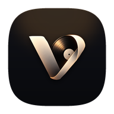

<div align="center">

  

  # Veyl

  *Reference-grade, bit-perfect Android music player powered by Rust & Jetpack Compose*

  [-3DDC84?style=flat-square&logo=android&logoColor=white)](https://developer.android.com)
  [](https://www.rust-lang.org)
  [](https://kotlinlang.org)
  [](https://developer.android.com/jetpack/compose)
  [](https://developer.android.com/ndk/guides/audio/aaudio/aaudio)
  [-FFB300?style=flat-square&logo=android&logoColor=black)](https://github.com/KARTHIKKJ369/Veyl/raw/main/veyl-debug.apk)

  ⭐ If you find Veyl useful, star the repository on GitHub!

  [Overview](#overview) • [Key Features](#key-features) • [Architecture](#architecture) • [Audio Engine Specifications](#audio-engine-specifications) • [Spotify Playlist Import](#spotify-playlist-import) • [Getting Started](#getting-started) • [Building from Source](#building-from-source)

</div>

---

## Overview

**Veyl** is a high-performance native Android music player engineered specifically for audiophiles. Traditional Android music players rely on the high-level Android media framework, which forces audio through the system mixer (`AudioFlinger`) where audio streams are often resampled and truncated.

Veyl bypasses system audio degradation by coupling a pure **Rust audio decoding & DSP engine** (`audiophile-core`) with **AAudio MMAP Exclusive Mode** hardware output. Whether rendering native DSD, 192 kHz / 24-bit FLAC from device storage, or streaming high-fidelity 320 kbps master tracks, Veyl delivers bit-perfect, zero-compromise acoustic fidelity.

> [!NOTE]
> When **Bit-Perfect (Exclusive Mode)** is enabled with a connected USB DAC, Veyl requests an unshared AAudio MMAP stream directly from the audio hardware HAL, matching the source file's native sample rate and bit depth with zero system mixing.

> [!TIP]
> Veyl features zero-configuration storage discovery. It automatically indexes your local music files (`/storage/emulated/0/Music`, SD card, and Android MediaStore) without requiring manual folder selection.

---

## Key Features

### Pure Rust Audio Engine (`audiophile-core`)
- **Multi-Format Decoding**: Powered by Symphonia with native support for FLAC, ALAC, WAV, AIFF, DSD (DSF/DFF), MP3, AAC, Ogg Vorbis, and Opus.
- **10-Band Parametric Biquad Equalizer**: Direct Form II Transposed filter bank with real-time transfer function computation and interactive curve plotting.
- **High-Order Sinc Resampling**: Wrapped Rubato 64-point sinc interpolation with Blackman-Harris windowing for precise sample-rate transitions.
- **TPDF Dithering**: Triangular Probability Density Function noise decorrelation preventing quantization distortion during bit-depth reduction.
- **Lock-Free Concurrency**: Dedicated audio rendering thread serviced by atomic ring buffers for zero-drop, zero-glitch playback.
- **Gapless Pre-Buffering**: Seamless track transitions with background pre-buffering across queue boundaries.

### Hardware-Direct Android HAL
- **AAudio MMAP Exclusive Stream**: Direct driver-level routing that circumvents OEM audio processing and mixer resampling.
- **Graceful Shared Fallback**: Automatically adopts high-precision shared audio streams on hardware without exclusive MMAP support.
- **Audio Focus & Call Ducking**: Complete Android audio focus lifecycle handling with smooth volume ramp-down during interruptions and seamless recovery.
- **Clean Background Service**: Foreground `PlaybackService` with zero-zombie background process cleanup when dismissed from recent apps.

### Modern Jetpack Compose UI
- **Zero-Lag List Architecture**: Pure text-only rows and efficient state hoisting ensure fluid 120 Hz scrolling across tens of thousands of tracks.
- **Interactive DSP Cockpit**: Live mathematical transfer function curve canvas ($20\text{ Hz} - 20\text{ kHz}$) with draggable filter nodes.
- **In-Place Synchronized Lyrics**: Word-level illuminated synchronized lyrics with tap-to-seek and ambient backdrop artwork.
- **Tactile Color Palettes**: Tailored high-contrast aesthetics including *Monochrome Carbon*, *Braun Dieter Rams*, *Macintosh Lab*, and custom user themes.
- **Unified Search & Filter**: Instant, non-blocking multi-category search across tracks, artists, and albums with inline library filters.

### Spotify Playlist Importer
- **Direct Link & ID Import**: Import playlists instantly via Spotify URLs (`open.spotify.com/playlist/...`) or playlist IDs.
- **4-Tier Intelligent Matching**: Matches imported tracks against local library audio using:
  1. Exact title and artist equality.
  2. Punctuation-stripped normalization.
  3. Parenthetical & subtitle removal (e.g., Remastered, Bonus Track).
  4. Token-set intersection matching.
- **Online Fallback Resolution**: Unmatched tracks are automatically resolved to high-fidelity online stream equivalents.

### High-Fidelity Online Studio Engine & Downloader
- **320 kbps Studio Streams**: Delivers master-quality streaming via low-latency CDN endpoints with sub-second playback start.
- **0 MB RAM Disk Cache**: Streamed data buffers directly into low-overhead temporary storage and routes into Symphonia without bloating RAM.
- **One-Tap Offline Download**: Saves tracks to `Music/Veyl/` with immediate Android MediaScanner registration for permanent offline playback.

---

## Architecture

Veyl is partitioned into a decoupled modular architecture connecting Kotlin/Compose to native Rust through Mozilla UniFFI.

```
┌─────────────────────────────────────────────────────────────────┐
│                 Jetpack Compose UI (Presentation)               │
│  - Now Playing Cockpit (Live visualizer, telemetry, scrubber)   │
│  - DSP Cockpit (Interactive biquad filter transfer curve)       │
│  - Library, Playlists, Albums, Artists, and Spotify Importer   │
│  - Foreground PlaybackService & Android MediaSession            │
└────────────────────────────────┬────────────────────────────────┘
                                 │ UniFFI (Kotlin <-> Rust)
┌────────────────────────────────▼────────────────────────────────┐
│                   Rust Core (`audiophile-core`)                 │
│  ├─ decode: Symphonia (FLAC, ALAC, WAV, DSD, MP3, AAC, Opus)    │
│  ├─ dsp: 10-Band Biquad EQ, Rubato Sinc Resampler, TPDF Dither  │
│  ├─ engine: Atomic RingBuffer, Lock-free Render Loop            │
│  ├─ library: Lofty metadata extraction & cover art scanner      │
│  └─ output: oboe-rs AAudio MMAP (Exclusive / Shared HAL)        │
└────────────────────────────────┬────────────────────────────────┘
                                 │ Android HAL / Direct Driver
┌────────────────────────────────▼────────────────────────────────┐
│               Hardware DAC / USB Audio Interface                │
└─────────────────────────────────────────────────────────────────┘
```

---

## Audio Engine Specifications

### Supported Formats

| Format | File Extensions | Bit Depth | Max Sample Rate | Decoding Engine |
| :--- | :--- | :--- | :--- | :--- |
| **FLAC** | `.flac` | 16, 24, 32-bit | Up to 384 kHz | Native Rust (Symphonia) |
| **ALAC** | `.m4a` | 16, 24-bit | Up to 192 kHz | Native Rust (Symphonia) |
| **WAV / AIFF** | `.wav`, `.aiff` | 16, 24, 32-bit | Up to 768 kHz | Native Rust (Symphonia) |
| **DSD** | `.dsf`, `.dff` | 1-bit | DSD64 / DSD128 / DSD256 | DoP / PCM Decimation |
| **MP3** | `.mp3` | 16-bit | Up to 48 kHz | Native Rust (Symphonia) |
| **AAC** | `.aac`, `.m4a` | 16-bit | Up to 96 kHz | Native Rust (Symphonia) |
| **Opus / Vorbis**| `.opus`, `.ogg` | 16, 24-bit | Up to 48 kHz | Native Rust (Symphonia) |

### 10-Band Parametric Biquad Equalizer

Each band implements a second-order IIR biquad filter operating in Direct Form II Transposed configuration:

$$H(z) = \frac{b_0 + b_1 z^{-1} + b_2 z^{-2}}{1 + a_1 z^{-1} + a_2 z^{-2}}$$

- **Band Frequencies**: 31 Hz, 62 Hz, 125 Hz, 250 Hz, 500 Hz, 1 kHz, 2 kHz, 4 kHz, 8 kHz, 16 kHz
- **Gain Range**: $-12.0\text{ dB}$ to $+12.0\text{ dB}$ with $0.1\text{ dB}$ precision
- **Filter Q**: Configurable $0.5$ to $4.0$ (default $1.414$ Butterworth)
- **Preamp Fader**: $-12.0\text{ dB}$ to $+6.0\text{ dB}$ digital headroom attenuation

---

## Spotify Playlist Import

Veyl lets you import entire playlists from Spotify without vendor lock-in:

1. Open **Playlists** in Veyl and tap **Import from Spotify**.
2. Paste any public playlist link or ID:
   ```
   https://open.spotify.com/playlist/37i9dQZF1DXcBWIGoYBM5M
   ```
3. Veyl fetches playlist metadata, normalizes track titles and artist strings, and scans your local storage for matching audio files.
4. Any missing tracks are supplemented with high-bitrate streaming references with album art.

---

## Getting Started

### Direct APK Download

Precompiled debug binaries are available directly from GitHub:

- **[Direct APK Download (`veyl-debug.apk`)](https://github.com/KARTHIKKJ369/Veyl/raw/main/veyl-debug.apk)**
- **[Latest GitHub Releases](https://github.com/KARTHIKKJ369/Veyl/releases/latest)**

### System Requirements

- **Android Version**: Android 8.0 (Oreo / API 26) or higher.
- **Recommended**: Android 10+ with USB OTG support for external USB DAC bit-perfect output.
- **Architectures**: `arm64-v8a`, `armeabi-v7a`, `x86_64`.

---

## Building from Source

### Prerequisites

Ensure you have the following installed on your host machine:

- **Rust toolchain** (1.75+):
  ```bash
  rustup target add aarch64-linux-android armv7-linux-androideabi x86_64-linux-android
  cargo install cargo-ndk
  ```
- **Android SDK & NDK** (NDK r25c or higher): Set `ANDROID_HOME` and `ANDROID_NDK_HOME` environment variables.
- **Java Development Kit**: JDK 17 (recommended: Eclipse Temurin or OpenJDK 17).
- **Gradle**: 8.0+ (or use included `./gradlew` wrapper).

### 1. Build Rust Core & Run Unit Tests

```bash
cd core-rust
cargo test
cargo build --release
```

### 2. Generate UniFFI Kotlin Bindings

```bash
cargo run --bin uniffi-bindgen generate \
  --library target/release/libaudiophile_core.dylib \
  --language kotlin \
  --out-dir ../core-rust-bindings/src/main/java
cd ..
```

### 3. Cross-Compile Native Libraries for Android

```bash
cd core-rust
cargo ndk -t arm64-v8a -t armeabi-v7a -t x86_64 \
  -o ../app/src/main/jniLibs build --release
cd ..
```

### 4. Assemble the Android APK

```bash
./gradlew :app:assembleDebug
```

The compiled APK will be generated at:
```
app/build/outputs/apk/debug/app-debug.apk
```

To install directly onto an adb-connected Android device:
```bash
adb install -r app/build/outputs/apk/debug/app-debug.apk
```
